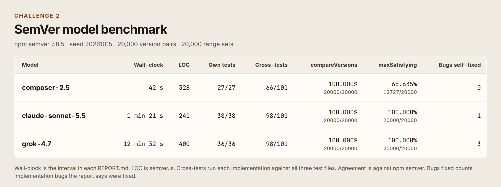

# Challenge 2 model comparison

Three models each implemented a dependency-free SemVer module in its own folder. This file records the prompt they shared and the numbers measured afterward. Wall-clock times and bug counts come from each model's `REPORT.md`. Line counts, test totals, and fuzz scores come from `judge/` (npm `semver` 7.8.5, seed `20261015`).

## Prompt

Each run started with one line that named the model and the folder to create. The task after that line was the same:

> Write a dependency-free JavaScript module `semver.js` exporting `compareVersions(a, b)` (returns -1/0/1) and `maxSatisfying(versions, range)` supporting full SemVer 2.0.0 precedence (prerelease identifiers, numeric vs alphanumeric, build metadata ignored) and ranges: exact, ^, ~, >=, <, x-ranges (1.2.x), and hyphen ranges (1.2.3 - 2.0.0). Include `semver.test.js` runnable with `node` (no deps) with at least 25 cases including tricky edge cases. Run the tests and report pass count. Also write `REPORT.md` in your folder with: model name, wall-clock time you took (start/end timestamps), lines of code, test results, any bugs you found and fixed during iteration, and a self-assessed limitations list.

The opening line was `BENCHMARK RUN (MODEL=<model>). Do not merge; open a PR only. Create folder challenge-2-model-benchmark/<model>/ and nothing else. Task (identical across models):` with `<model>` set to `composer-2.5`, `claude-sonnet-5-5` (folder `claude-sonnet-5.5`), or `grok-4.7`.

## How the judge measured

- **Own tests.** `node semver.test.js` in that model's folder.
- **Cross-tests.** Every implementation ran against all three test files (101 cases). `require('./semver')` and `require('./semver.js')` were pointed at the implementation under test. All three modules already exported `compareVersions` and `maxSatisfying`, so the normaliser did not rename anything.
- **Fuzz.** The same 20,000 version pairs and the same 20,000 range sets were given to every model and to npm `semver` 7.8.5. Of the pairs, 14,978 include a prerelease and 12,782 include build metadata. Range sets are 2,500 exact, 2,500 `^`, 2,500 `~`, 2,000 `>=`, 2,000 `<`, 2,500 x-ranges, 2,000 hyphen ranges, plus 1,000 each of `>`, `<=`, space-separated AND, and `||`.
- **compareVersions agreement.** The same return value, `-1`, `0`, or `1`. A throw counts as a miss.
- **maxSatisfying agreement.** Both results are null, or both are strings that npm `semver.compare` treats as equal. Exact string match was also recorded and, on this run, matched the semantic score for every model.

Re-run with `npm install` and `npm run judge` in `challenge-2-model-benchmark/judge/`. Raw output is `judge/results.json`.

## Results

| Model | Wall-clock | LOC | Own tests | Cross-tests | compareVersions | maxSatisfying | Bugs self-fixed |
|---|---:|---:|---:|---:|---:|---:|---:|
| composer-2.5 | 42 s | 328 | 27/27 | 66/101 | 100.000% (20000/20000) | 68.635% (13727/20000) | 0 |
| claude-sonnet-5.5 | 1 min 21 s | 241 | 38/38 | 98/101 | 100.000% (20000/20000) | 100.000% (20000/20000) | 1 |
| grok-4.7 | 12 min 32 s | 400 | 36/36 | 98/101 | 100.000% (20000/20000) | 100.000% (20000/20000) | 3 |

Wall-clock is the interval printed in `REPORT.md`: composer-2.5 from 2026-10-15 04:08:01 to 04:08:43; claude-sonnet-5.5 from 2026-10-15T04:09:59Z to 2026-10-15T04:11:20Z; grok-4.7 from 2026-10-15T04:07:00Z to 2026-10-15T04:19:32Z. LOC is the line count of `semver.js`. Bugs self-fixed counts implementation bugs the report says were fixed. Test-only edits are separate: claude-sonnet-5.5 corrected 2 expectations, grok-4.7 corrected 1 assertion (`-0` versus `0`), and composer-2.5 removed unused helpers after a first run that already passed.

Cross-test split, in folder order composer-2.5 / claude-sonnet-5.5 / grok-4.7:

- composer-2.5: 27/27, 23/38, 16/36
- claude-sonnet-5.5: 27/27, 38/38, 33/36
- grok-4.7: 27/27, 35/38, 36/36

composer-2.5 `maxSatisfying` agreement by range form: exact 2500/2500, `^` 1903/2500 (76.120%), `~` 1816/2500 (72.640%), `>=` 1322/2000 (66.100%), `<` 698/2000 (34.900%), x-range 1789/2500 (71.560%), hyphen 1588/2000 (79.400%), `>` 646/1000 (64.600%), `<=` 800/1000 (80.000%), AND 654/1000 (65.400%), `||` 11/1000 (1.100%). On the seven forms named in the prompt the score is 11616/16000 (72.600%). On the four extra forms it is 2111/4000 (52.775%). The other two models scored 2500/2500, 2000/2000, or 1000/1000 on every form. Exact string agreement equalled semantic agreement for all three (composer-2.5 13727/20000, the others 20000/20000).

The six cross-test misses between claude-sonnet-5.5 and grok-4.7 are outside that valid-input fuzz. Checked against npm `semver` 7.8.5 on the failing cases:

- grok-4.7 throws `Error` on `compareVersions('1.2', '1.0.0')`. npm throws `TypeError`. claude-sonnet-5.5 throws `TypeError` with message `Invalid version: 1.2`, which does not match the grok test's `/invalid semver/` check.
- `maxSatisfying` on an empty range returns `2.0.0` from npm and from claude-sonnet-5.5 for the x-range fixture `['1.1.9', '1.2.0', '1.2.7', '1.3.0', '2.0.0']`. grok-4.7 returns null.
- `maxSatisfying(['1.0.0'], '>=')` and `maxSatisfying(['1.0.0'], 'not')` return null from npm and from grok-4.7. claude-sonnet-5.5 throws `TypeError`.
- `maxSatisfying(['1.2.9', '1.3.0'], '1.2.x-beta')` returns `1.2.9` from npm and from grok-4.7. claude-sonnet-5.5 throws `TypeError`.

## Pros and cons

### composer-2.5

Pros: the report's clock is 42 seconds, the shortest of the three. The module is 328 lines, its 27 tests passed, and `compareVersions` matched npm on all 20,000 pairs, including the pairs with prereleases and build metadata. Exact ranges matched on all 2,500 cases.

Cons: `maxSatisfying` matched on 13,727 of 20,000 cases (68.635%). The `<` slice was 698/2000 and the `||` slice was 11/1000. Cross-tests passed 66 of 101 cases. The report records no failing test and no bug fix. Its listed limits line up with the low slices: `||` at 11/1000, and the 12 saved caret misses include partials such as `^1` and `^0` plus prerelease bounds such as `^3.1.3-rc5`.

### claude-sonnet-5.5

Pros: the smallest module, 241 lines. Own tests 38/38. Cross-tests 98/101. Both fuzz functions matched npm on 20,000 of 20,000 cases, and the returned `maxSatisfying` string was the same string npm returned every time. The report's timed stretch, from the first shell command to the last passing test run, is 1 minute 21 seconds. One parser bug (`1.x.3` accepted as a range) was fixed in that run.

Cons: 3 of grok-4.7's 36 tests failed. An invalid range throws, while npm returns null. `1.2.x-beta` throws, while npm returns `1.2.9`. The invalid-version error text does not match `/invalid semver/`. The report also says about 1 to 2 minutes of planning before the first command are outside the 1 minute 21 seconds.

### grok-4.7

Pros: own tests 36/36. Cross-tests 98/101. Both fuzz functions matched npm on 20,000 of 20,000 cases, with the same exact strings as npm. `1.2.x-beta` and invalid ranges agree with npm on the cases above. The report lists three implementation fixes: `>` and `<=` on partial versions, a leading `V`, and a prerelease suffix on a wildcard.

Cons: the report's clock is 12 minutes 32 seconds, and `semver.js` is 400 lines. 3 of claude-sonnet-5.5's 38 tests failed. An empty range returns null; npm returns `2.0.0` for that fixture. An invalid version throws `Error`; npm throws `TypeError`. The report's fourth iteration fix was a test assertion: `Object.is` treats `0` and `-0` as different, and the comparator had returned `0`.

## Verdict

`compareVersions` matched npm semver for every model on all 20,000 pairs. `maxSatisfying` matched on all 20,000 range sets for claude-sonnet-5.5 and grok-4.7, and on 13,727 for composer-2.5. claude-sonnet-5.5 and grok-4.7 also tied on cross-tests at 98/101. claude-sonnet-5.5 did that in 241 lines with a reported 1 minute 21 seconds. grok-4.7 did it in 400 lines with a reported 12 minutes 32 seconds. composer-2.5 was the fastest report, at 42 seconds, and passed its own tests, with range agreement at 68.635%.

