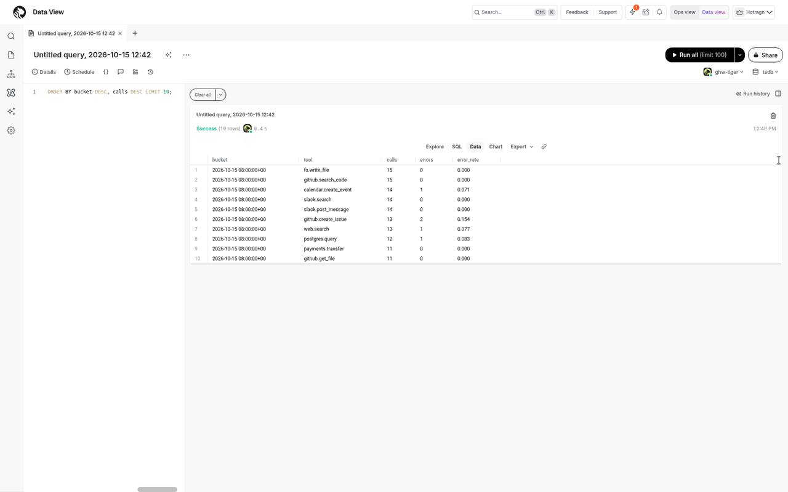
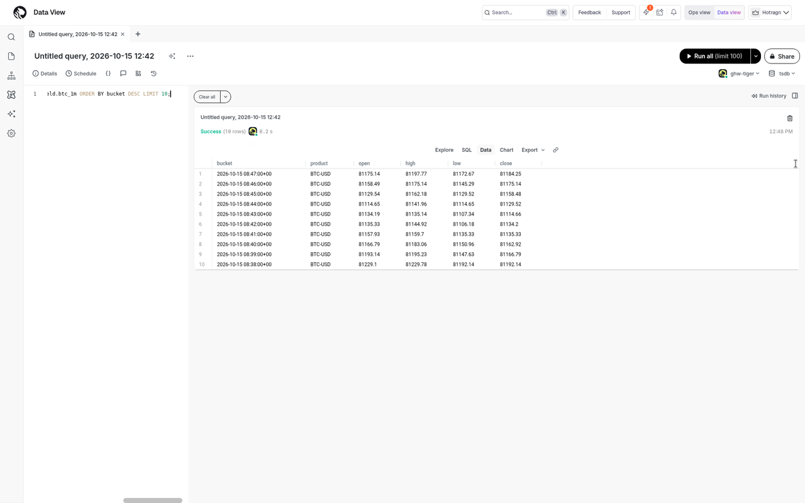
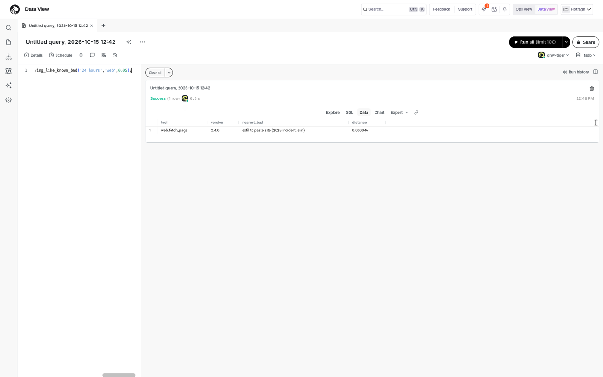
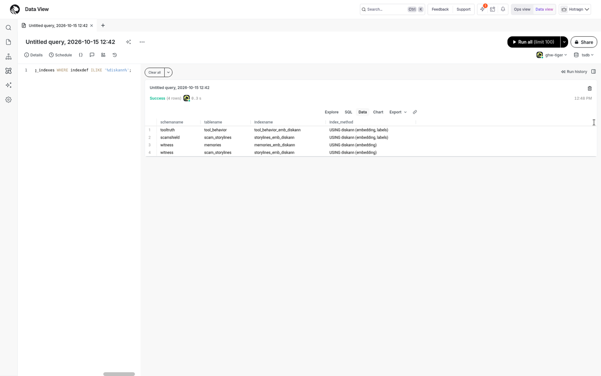
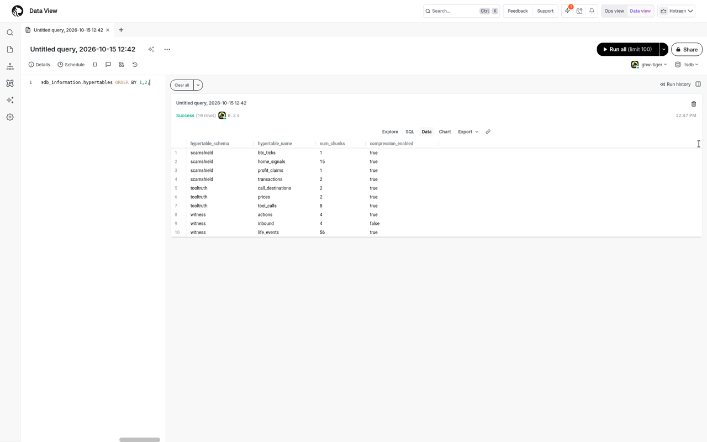
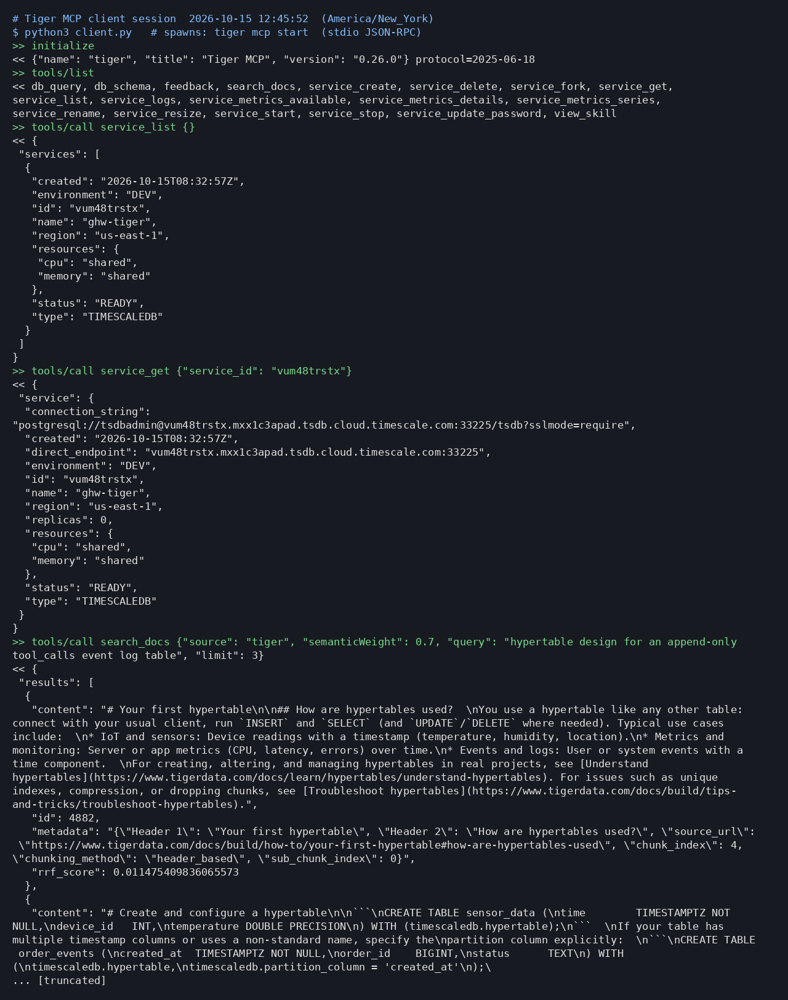

# Tiger Cloud proof

Screenshots and a transcript from the live Tiger Cloud service `ghw-tiger` (TimescaleDB, us-east-1).

## Continuous aggregates

Shows a continuous aggregate that incrementally rolls raw time-series rows up into time buckets, queried live.

## Financial OHLC candles

Shows open/high/low/close candles computed in TimescaleDB from real Coinbase trade data.

## pgvector similarity search

Shows nearest-neighbour similarity search over embeddings using pgvector distance operators.

## DiskANN indexes

Shows DiskANN (pgvectorscale) vector indexes created on the embeddings table and used by the query planner.

## Hypertables

Shows tables converted to hypertables, automatically partitioned into time-based chunks.

## Live MCP session

Shows a live MCP session started with `tiger mcp start` (Tiger MCP v0.26.0) listing its 19 tools and calling `service_list` / `service_get`. Full transcript: [mcp.txt](mcp.txt).
