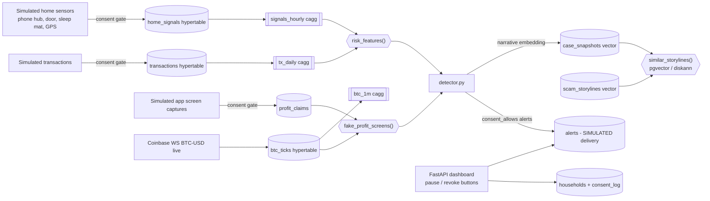

# ScamShield Home — consent-based early warning for elder fraud

Scams like pig-butchering, tech-support refunds and grandparent emergencies leave traces before the money is gone: late-night calls from overseas, cash deposits at a crypto kiosk, a broken sleep pattern, a stranger at the door. ScamShield Home stores these **simulated** home signals and transactions in **Tiger Cloud (TimescaleDB)**. It catches "investment apps" that show a fake BTC price by comparing the screen against the **live Coinbase BTC-USD** price. It also matches the household's pattern to known scam storylines with **pgvector**. When the risk is high, it writes an alert for a trusted contact. **Alerts are simulated and never sent.**

## Consent and off-switch design
- Only the elder grants consent. Each scope is separate (`calls, door, sleep, location, transactions, screens, alerts`), and every grant, pause and revoke goes to `consent_log`.
- `consent_allows(household, scope)` gates **every ingest and every alert**. In the demo, Helen's consent is *pending*, so her 127 events are dropped at ingest.
- **Pause** (`pause_monitoring`) stops alerts for a set time. **Revoke** (`revoke_consent`) stops everything and **deletes raw signals, screen captures and snapshots**.
- Data minimisation: retention policies drop raw in-home signals after 30 days. Only hourly rollups are kept (180 days).
- Alerts tell the trusted contact to check in kindly, not to confront. Nothing leaves the database.



## Run
```bash
python -m venv .venv && . .venv/bin/activate && pip install -r requirements.txt
cp .env.example .env
python -m scamshield.setup_db
python -m scamshield.simulator --backfill-days 14       # IoT dataset + metadata (devices table) + tx valued at live BTC
python -m scamshield.simulator --live &                 # live Coinbase BTC-USD ticks + live fake-profit screens
python -m scamshield.detector --loop 300 &
uvicorn scamshield.api:app --port 8102                  # http://localhost:8102
```

## Local test results
- hh-001 Rosa: risk 0.95. Nearest storyline is "Pig-butchering crypto romance". The app showed BTC 18–42% above the real Coinbase price.
- hh-002 Walter: risk 0.65. Nearest storyline is "Tech-support refund scam".
- hh-003/004: risk 0.00. Nearest storyline is "Normal routine (benign"]. hh-005 has pending consent and is not analysed.
- Revoking hh-004 deleted 110 raw signals and wrote an audit entry.

## Production and tests
- Migrations: `python -m scamshield.setup_db` (checksum-tracked). Least-privilege roles: `sql/roles.sql`. Deployment: [../PRODUCTION.md](../PRODUCTION.md).
- API key: set `SCAMSHIELD_API_KEY` (required when `SCAMSHIELD_ENV=prod`). Inputs are validated, rate-limited, and logged as JSON with request ids. Probes: `/healthz`, `/readyz`.
- Container: `docker compose up --build` (`--profile demo` backfills, `--profile live` starts workers).
- Tests: `pip install -r requirements-dev.txt && TEST_DB_URL=postgres://... pytest` (unit + integration; integration **drops the `scamshield` schema in the test DB**).
