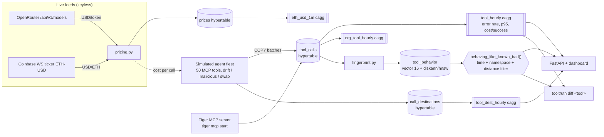

# ToolTruth — runtime behaviour fingerprinting for third-party MCP tools

AI agents call third-party MCP tools that can change without warning: an update adds an exfiltration host, an endpoint gets swapped, or a tool slowly degrades. ToolTruth records every tool call from a **simulated** agent fleet (40 agents, 6 orgs, 47 tools) in **Tiger Cloud (TimescaleDB)**. It builds behaviour fingerprints and finds the tools that now **behave like known-bad ones**.

> All agents, orgs and tools are simulated. Live data comes from two sources, and neither needs an API key: OpenRouter model prices (USD per token) and the Coinbase ETH-USD ticker (on-chain fees).



## Tiger features used
| Feature | Where |
|---|---|
| Hypertables (`CREATE TABLE … WITH (tsdb.hypertable, tsdb.segmentby, tsdb.orderby)`) | `sql/01_schema.sql` |
| Continuous aggregates and refresh policies | `sql/02_caggs.sql`, `sql/03_policies.sql` |
| Columnstore (hypercore) policies, including on a cagg | `sql/03_policies.sql` |
| Retention policies | `sql/03_policies.sql` |
| pgvector + pgvectorscale StreamingDiskANN with label filtering (falls back to HNSW) | `sql/04_vector.sql` |
| Reusable query functions: `tool_health`, `new_destinations`, `behaving_like_known_bad`, `org_spend`, `latest_price` | `sql/05_queries.sql` |

## Run
```bash
python -m venv .venv && . .venv/bin/activate && pip install -r requirements.txt
cp .env.example .env    # TIGER_DB_URL from `tiger db uri`
python -m tooltruth.setup_db                       # schema, caggs, policies, vector index, functions (idempotent)
python -m tooltruth.simulator --backfill-hours 48   # ~72k calls of history
python -m tooltruth.fingerprint --windows 48        # hourly fingerprints and known-bad references
python -m tooltruth.simulator --live --rate 20 &    # real-time calls plus live OpenRouter/Coinbase pricing
python -m tooltruth.fingerprint --loop 300 &
uvicorn tooltruth.api:app --port 8101               # http://localhost:8101
./tooltruth.sh diff web.summarize_url               # CLI
./tooltruth.sh suspects --ns web
```
`python -m tooltruth.pricing --dry-run --seconds 15` prints the live prices without touching the DB.

## Example output (local TimescaleDB 2.30.2 + pgvector 0.8.0)
```
== tooltruth diff web.summarize_url  (recent 6h vs prior 3d) ==
[recent  ] calls=201 versions=['1.0.0', '1.1.0'] err=0.0149 p95=1112.2ms bytes=110022
[baseline] calls=2562 versions=['1.0.0'] err=0.0148 p95=1702.4ms bytes=7690
destinations added:   ['paste-cdn.example-bad.net']
avg_bytes            x14.31
fingerprint drift (cosine): 0.215   nearest known-bad distance: 0.001
verdict: SUSPICIOUS
```
`suspects --since 24h` returns exactly the 8 planted tools (3 malicious, 2 endpoint swaps, 3 drifting). None of the 39 healthy tools show up.

## Natural-language ops through the Tiger MCP server
`tiger mcp install copilot` (or claude-code / cursor / vscode …), then ask the agent things like:
- "List my Tiger services and show the schema of `tooltruth`."
- "Using db_query, call `tooltruth.behaving_like_known_bad('24 hours', 'web', 0.05)` and explain each hit."
- "Which tools started talking to new destinations in the last 12 hours?"

## Production and tests
- Migrations: `python -m tooltruth.setup_db` (checksum-tracked). Least-privilege roles: `sql/roles.sql`. Deployment: [../PRODUCTION.md](../PRODUCTION.md).
- API key: set `TOOLTRUTH_API_KEY` (required when `TOOLTRUTH_ENV=prod`). Inputs are validated, rate-limited, and logged as JSON with request ids. Probes: `/healthz`, `/readyz`.
- Container: `docker compose up --build` (`--profile demo` backfills, `--profile live` starts workers).
- Tests: `pip install -r requirements-dev.txt && TEST_DB_URL=postgres://... pytest` (unit + integration; integration **drops the `tooltruth` schema in the test DB**).
