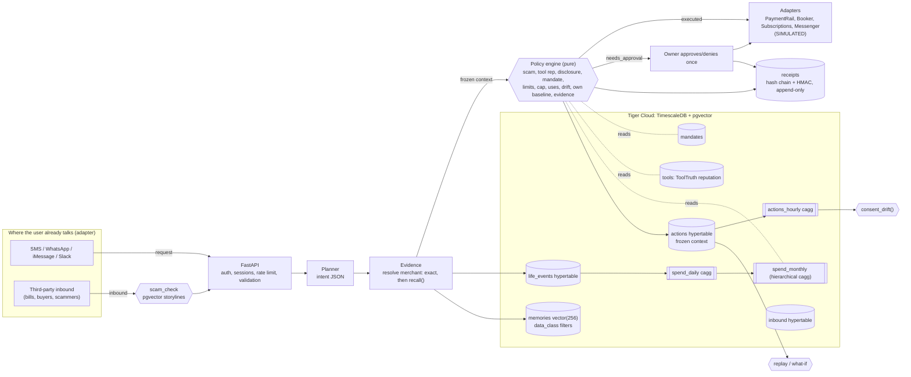

# Witness — the personal agent that can prove it

Personal agents now pay bills, cancel subscriptions, book tables and answer Marketplace buyers for you. The failures reported in their first month are the same every time: an agent **shared a home address nobody approved**, **stated an assumption as a fact**, **made the wrong cancellation**, and **nobody could prove what the user had authorised**. Witness is a personal agent built around one rule: **an action happens only if the agent can show *why it was allowed* and *what evidence it relied on*, and the user can check that proof later.**

Witness keeps a **time-series memory of your life** in **Tiger Cloud (TimescaleDB + pgvector)**: bills, subscriptions, spending habits and the agent's own actions. Before anything runs, the agent checks that memory, your **mandates** (scoped, revocable delegated authority), the **reputation of the tool** it would use, and a **scam check** on whoever asked. Each decision is stored with its **full frozen context**, and each one produces a **hash-chained, signed receipt**.

> **Everything is simulated.** The people, bills, merchants and tools are demo data. Execution goes through simulated adapters (`witness/adapters.py`). No message is sent and no money moves.

## What makes it different
| Capability | What it means for the user | Where |
|---|---|---|
| **Evidence-bound actions** | Every plan cites the `life_events` rows it relied on. A fact it cannot cite becomes an *assumption*, and any assumption sends the action back to you. This is aimed at the "reported an assumption as a fact" failure. | `agent.build_context`, rule `evidence_bound` |
| **Own-baseline guard** | "$412 to ConEd" is checked against **your** history (monthly cagg), not a global limit. If it is more than 1.5× your usual, Witness asks first. | `merchant_baseline()` over `spend_monthly` |
| **Protected data classes** | Address, health and financial data can be revealed only under a mandate that names that data class. "Allow always" for replies does **not** cover your address. | rule `data_disclosure` |
| **Consent-drift guard** | A standing mandate has a daily budget. `consent_drift()` shows when the agent is using it far more than when you set it up. | `actions_hourly` cagg |
| **Deterministic replay + what-if** | The policy engine is a pure function of the stored context. Every past decision replays exactly, and you can ask "what if I had set this rule last month?" | `agent.replay`, `POST /api/replay` |
| **Signed, append-only receipts** | Each receipt is SHA-256 chained per user (checked in SQL) and HMAC-signed (checked in Python). A trigger and DB grants block UPDATE/DELETE. | `receipts`, `verify_chain()` |
| **Vetted tools only** | Each adapter maps to a tool with a ToolTruth-style reputation and drift flag. Low reputation or drift blocks the action. | `tools`, rule `tool_reputation` |
| **Scam check on inbound asks** | When a third party asks for money, the message is compared with known scam storylines (pgvector, ScamShield-style) before planning. | `scam_check`, `scam_storylines` |
| **Money-saving insights** | Subscription price creep, paying-but-not-using, and monthly spend, all from caggs. | `subscription_creep()`, `idle_subscriptions()` |

## Why this beats Instinct / Muse / dots / Poke
| | Instinct | Meta Muse | OpenAI dots | Poke | **Witness** |
|---|---|---|---|---|---|
| Where it lives | SMS / calls, its own phone + computer [1][2] | WhatsApp, app, web; isolated cloud VM per user [5][6] | ChatGPT, Slack, Teams [8][9] | iMessage, SMS, Telegram [12] | Any channel through the `Messenger` adapter (user's `home_channel`) |
| Permission model | Access to connected accounts, email, messages [10] | "Allow One Time / Allow Always" connectors [11] | Custom rules: allow / approve / block [8][9] | Account-level | **Scoped mandates**: per action, counterparty, amount, rolling cap, uses, expiry, daily budget, and disclosable data classes |
| Proof of what you authorised | Not published | Not published | Review in app | Not published | **Signed, hash-chained receipt per decision + approval**, verifiable offline |
| Hallucinated facts | Agent "reported an assumption as a fact" [10] | Fabrications reported [10] | Not published | Not published | **Uncited facts are blocked**; every plan lists its evidence rows |
| Sensitive-data leaks | Read a login code from Gmail without asking [10] | Shared a user's home address with a buyer [11] | Checks before sharing private context [8] | Not published | **Protected classes** need an explicit grant |
| Anomaly vs your own habits | Hallucination detection before execution [4] | Not published | Not published | Not published | **Per-merchant baseline from time-series memory** |
| "What if I'd set this rule?" | No | No | No | No | **Deterministic replay of every past decision** |
| Tool trust | First-party | First-party connectors, self-written connectors [6] | 4,000+ plugins [9] | Not published | **Reputation + drift gate** (ToolTruth feed) |
| Scam-aware | Not published | Not published | Not published | Not published | **Inbound scam check** before acting |

This fits the investor thesis: own the channel (adapter), get **permission to act** (mandates the user can read), and offer a **trusted way to pay** (receipts that banks are now asking for [14][15]). It builds on the open layers of memory (Tiger time-series + vectors), agent security (policy + tool reputation) and agent payments (AP2-compatible mandate shape [17]).

## Architecture


## Tiger features used
| Feature | Where |
|---|---|
| Hypertables: `life_events`, `actions`, `inbound` | `sql/01_schema.sql` |
| Continuous aggregates, including a **hierarchical cagg** (`spend_monthly` on `spend_daily`), with refresh policies | `sql/02_caggs.sql` |
| Compression + retention (raw memory 400 days; habits kept in caggs; receipts never dropped) | `sql/03_policies.sql` |
| pgvector memory with filtered recall (kind, data class, time window); uses DiskANN when pgvectorscale exists, else HNSW | `sql/04_vector.sql`, `recall()` |
| Reusable SQL: `merchant_baseline`, `subscription_creep`, `idle_subscriptions`, `consent_drift`, `verify_chain` | `sql/05_queries.sql` |

## Run locally
```bash
python -m venv .venv && . .venv/bin/activate && pip install -r requirements-dev.txt
cp .env.example .env                       # TIGER_DB_URL + WITNESS_SIGNING_KEY
python -m witness.setup_db                 # migrations (checksum-tracked)
python -m witness.simulator --reset        # demo users, 13 months of memory, 14-day scenario replay
uvicorn witness.api:app --port 8103        # http://localhost:8103  (maya@demo.witness.local / witness-demo-pass)
```
Or use `docker compose up --build`, then `docker compose --profile demo run seed`. See [DEPLOY.md](DEPLOY.md) for Tiger Cloud and [SECURITY.md](SECURITY.md) for the security model.

### API (all routes need a session except auth and health)
`POST /api/auth/register|login|logout` · `GET /api/me` · `POST /api/requests {text}` · `POST /api/inbound {channel,sender,body}` · `GET /api/actions` · `POST /api/actions/{id}/approve|deny` · `GET /api/receipts`, `/api/receipts/verify` · `GET|POST /api/mandates`, `POST /api/mandates/{id}/revoke` · `GET /api/insights` · `GET /api/recall?q=` · `POST /api/replay {since_days, params, mandate_patch}` · `GET /api/evidence/{event_id}` · `/healthz`, `/readyz`

### Plugging in real providers
Implement the Protocols in `witness/adapters.py` (`PaymentRail`, `SubscriptionManager`, `Booker`, `Messenger`, `ToolReputationFeed`), register them in `registry()`, and set `WITNESS_ADAPTERS`. Adapters must be idempotent on `idempotency_key` (the action id). The planner is deterministic today. An LLM planner can replace `parse()` as long as it emits the same intent JSON, because the policy engine, evidence binding and receipts do not change.

## Test results (local TimescaleDB 2.30.2 + pgvector 0.8.0)
`pytest`: **26 passed** (14 unit + 12 integration). The suite covers migrations (idempotent), hypertables and caggs, scenario outcomes, evidence citing, chain verification and tamper rejection, exact replay plus what-if diffs, insight queries, auth and cross-user isolation, validation envelopes, register → request → approve-once → receipts, inbound scam via API, and health. Scenario highlights:
- "pay the electric bill" → pgvector recall resolves **ConEd**, cites the bill row, executes (simulated).
- "pay my coned bill $412" → **needs approval** (more than 1.5× Maya's usual).
- "reply to buyer jo … here is my address" → **blocked** (address is a protected class; the reply mandate does not grant it).
- A second Lucia's booking → **needs approval** (one-time mandate already used).
- Grace (74): the IRS gift-card text and the "grandchild bail" text are **blocked**. The real ConEd notice executes.
- Replay: **40/40** past decisions reproduced exactly. "Marketplace max 2/day" would have changed several actions to approval.

## Sources (gathered 2026-10-15)
1. TechCrunch, Instinct $1B Series C — https://techcrunch.com/2026/09/28/viral-ai-agent-instinct-raises-1b-series-c-at-a-10b-valuation/
2. Reuters, Instinct raise — https://www.reuters.com/technology/ai-agent-firm-instinct-raises-1-billion-latest-funding-round-2026-09-28/
3. SiliconANGLE, Instinct — https://siliconangle.com/2026/09/28/everyday-personal-ai-assistant-startup-instinct-raises-1b-at-10b-valuation/
4. Yahoo Finance / Investing.com, Instinct hallucination detection — https://finance.yahoo.com/technology/ai/articles/ai-agent-startup-instinct-hits-180634951.html
5. AP, Meta launches Muse — https://apnews.com/article/meta-muse-ai-agent-3a4572eb4cf4e95d8a0dfdad6e6ca065
6. Meta AI Research, Safety in Muse — https://research.meta.ai/blog/security-and-safety-for-ai-agents-our-approach-with-muse
7. Reuters, Muse internal concerns — https://www.reuters.com/business/meta-launches-ai-agent-that-can-access-other-apps-send-emails-make-payments-2026-09-08/
8. OpenAI, Meet dots — https://learn.chatgpt.com/docs/dots
9. OpenAI, Introducing dots — https://openai.com/index/introducing-dots/ and https://chatgpt.com/features/dots/
10. Business Insider, personal-agent horror stories — https://www.businessinsider.com/ai-agents-gone-wrong-horror-stories-instinct-muse-privacy-security-2026-9
11. The Guardian, Muse shared a home address — https://www.theguardian.com/technology/2026/sep/28/metas-ai-agent-muse-home-address
12. TechCrunch, Poke — https://techcrunch.com/2026/04/08/poke-makes-ai-agents-as-easy-as-sending-a-text/ ; Poke FAQ https://poke.com/faq
13. The Conversation, Can anyone prove you authorised it? — https://theconversation.com/an-ai-agent-spent-your-money-can-anyone-prove-you-authorized-it-288485
14. PYMNTS, Banks call for an AI shopping audit trail — https://www.pymnts.com/news/artificial-intelligence/2026/banks-want-audit-trail-from-ai-shopping-instructions-payment-outcome/
15. Payments Dive, Agentic payment risk — https://www.paymentsdive.com/news/how-agentic-payments-artificial-intelligence-risk/832601/
16. Prior art, signed mandates + receipts (TypeScript library, no memory/baseline/replay) — https://github.com/vanticlabs/vantic
17. AP2 specification — https://ap2-protocol.org/ap2/specification/
